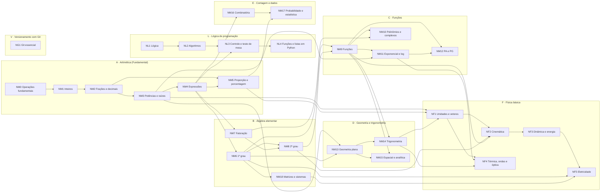

# Fase 0 — Nivelamento

O nivelamento reconstrói a base de matemática, física e lógica de programação antes do plano principal. Parte do pressuposto de que existem lacunas: cada bloco começa com um diagnóstico, e só se estuda o que o diagnóstico mostrar que falta. São 28 módulos, com no máximo 790 h se nada for dispensado.

Os módulos ficam em `disciplinas/` com prefixo `NM` (matemática), `NF` (física) e `NL` (lógica de programação). O andamento aparece no [PROGRESSO.md](PROGRESSO.md).

## Trilhas e dependências

Cada seta indica "é pré-requisito de". Módulos sem seta entre si podem correr em paralelo.

O diagrama é gerado a partir dos cabeçalhos dos módulos por `python scripts/diagrama.py`; não edite à mão o trecho entre os marcadores.

<!-- diagrama:inicio -->

<!-- diagrama:fim -->

## Ordem recomendada

O NM0 abre o nivelamento: reforça as quatro operações com números naturais, com quatro listas de 110 exercícios cada e uma lista de problemas-âncora em [exercicios/NM0](exercicios/NM0/).

A ordem alterna uma trilha pesada (matemática ou física, nas manhãs) com uma trilha leve (lógica, à noite ou no almoço). Os módulos marcados com ★ são a **rota crítica antes do início do curso**: cobrem o que as unidades do primeiro semestre da graduação (Python e Matemática Discreta, Lógica e Matrizes) já pressupõem.

| # | Módulo | Horas máx. | Pré-requisitos | Rota crítica |
| --- | --- | --- | --- | --- |
| 0 | NM0 Operações fundamentais | 40 | — | ★ |
| 1 | NM1 Números inteiros e operações | 20 | NM0 | ★ |
| 2 | NL1 Lógica proposicional e raciocínio | 20 | — | ★ |
| 3 | NM2 Frações e números decimais | 25 | NM1 | ★ |
| 4 | NL2 Algoritmos e pensamento computacional | 20 | NL1 | ★ |
| 5 | NM3 Potenciação, radiciação e notação científica | 20 | NM2 | ★ |
| 6 | NM4 Expressões numéricas e algébricas | 20 | NM3 | ★ |
| 7 | NL3 Estruturas de controle e teste de mesa | 30 | NL2, NM4 | ★ |
| 8 | NM5 Razão, proporção, regra de três e porcentagem | 30 | NM2, NM4 | ★ |
| 9 | NM6 Equações, inequações e sistemas do 1º grau | 25 | NM4 | ★ |
| 10 | NL4 Funções, listas e primeiros programas em Python | 35 | NL3 | ★ |
| 11 | NM18 Matrizes, determinantes e sistemas lineares | 25 | NM6 | ★ |
| 12 | NM7 Produtos notáveis e fatoração | 20 | NM4 | |
| 13 | NM16 Análise combinatória | 25 | NM4 | |
| 14 | NM8 Equações do 2º grau e redutíveis | 25 | NM6, NM7 | |
| 15 | NM9 Conjuntos e funções | 40 | NM6, NM8 | |
| 16 | NM13 Geometria plana | 35 | NM3, NM6 | |
| 17 | NM11 Funções exponenciais e logaritmos | 30 | NM3, NM9 | |
| 18 | NM17 Probabilidade e estatística básica | 30 | NM5, NM16 | |
| 19 | NM10 Polinômios e números complexos | 25 | NM7, NM9 | |
| 20 | NM12 Sequências: PA e PG | 20 | NM9, NM11 | |
| 21 | NM14 Trigonometria | 40 | NM9, NM13 | |
| 22 | NM15 Geometria espacial e analítica | 35 | NM9, NM13 | |
| 23 | NF1 Grandezas, unidades e vetores | 20 | NM3, NM5, NM14 | |
| 24 | NF2 Cinemática | 30 | NF1, NM8, NM9 | |
| 25 | NF3 Dinâmica, trabalho e energia | 40 | NF2 | |
| 26 | NF4 Termologia, ondas e óptica | 30 | NF1, NM11, NM14 | |
| 27 | NF5 Eletricidade e magnetismo básicos | 35 | NF3, NM6, NM18 | |

Totais máximos: matemática 530 h, lógica de programação 105 h, física 155 h.

## Como o nivelamento se liga ao plano principal

A antiga disciplina M0 (Pré-cálculo) deixou de existir: o nivelamento a substitui. Os pré-requisitos do plano principal passam a apontar para os módulos:

| Disciplina do plano | Depende agora de |
| --- | --- |
| M1 Lógica, provas e conjuntos | NM4, NL1 |
| P1 Programação e abstração | NL4 |
| M3 Cálculo I | NM9, NM11, NM14 |
| M5 Álgebra linear | NM9, NM18, M1 |
| M2 Matemática discreta | M1, NM16 |
| M4 Cálculo multivariável | M3, M5, NM15 |
| M6 Probabilidade | M2, M3, M4, NM17 |
| F1 Mecânica clássica | M3, NF3 |
| F2 Eletricidade e magnetismo | F1, M4, NF5 |
| F3 Termodinâmica e ondulatória | F1, M4, NF4 |

O script não deixa abrir essas disciplinas antes dos módulos correspondentes.

## Quanto tempo leva

O total depende do diagnóstico. As faixas abaixo usam as janelas da rotina de dias úteis, sem contar fins de semana.

| Cenário | Horas de estudo | Antes do curso (≈ 24 h/semana) | Durante o curso (≈ 15 h/semana) |
| --- | --- | --- | --- |
| Lacunas em quase tudo | ≈ 790 h | ≈ 33 semanas | ≈ 53 semanas |
| Lacunas típicas (cerca de 40% dispensado) | ≈ 450 h | ≈ 19 semanas | ≈ 30 semanas |
| Base razoável (cerca de 70% dispensado) | ≈ 230 h | ≈ 10 semanas | ≈ 15 semanas |

Antes do curso começar, as noites e a manhã de quarta também vão para o nivelamento. Depois que o curso começa, o nivelamento ocupa as quatro manhãs do complemento e os almoços, e a rota crítica (★) deve estar concluída antes das unidades do curso que dependem dela.

## Avaliações

Diagnósticos, exercícios, provas de saída e revisões seguem o protocolo de [AVALIACOES.md](AVALIACOES.md).
