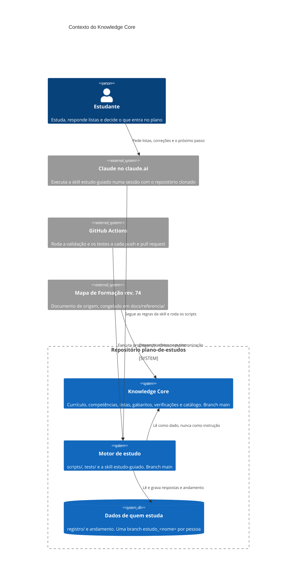

# Visão do Knowledge Core

## O que é

O Knowledge Core é a parte do repositório que descreve **o que se estuda**: os 86 módulos e disciplinas, os pré-requisitos entre eles, as competências, as listas de exercícios com gabarito e verificação, e o catálogo de eixos, unidades, projetos e escalas. É a fonte de verdade do plano de formação ([ADR 0001](../adr/0001-git-fonte-de-verdade.md)).

Ele não é um acervo de materiais a reorganizar. É um currículo estruturado em arquivos abertos (Markdown e YAML), validado por script e pelo CI ([ADR 0002](../adr/0002-markdown-e-yaml-sem-banco.md)). O motor de estudo e os registros de quem estuda usam o Core, mas não fazem parte dele.

A origem desta visão é a [auditoria de 25/11/2026](auditoria.md), seções 7 a 9.

## Três estágios

O repositório evolui em três estágios. Cada um só começa quando o anterior tem uso real.

| Estágio | O que entrega | Já existe | Marcos |
| --- | --- | --- | --- |
| 1. Knowledge Core | Currículo com IDs estáveis, schema, catálogo e validação | Grafo de pré-requisitos, códigos, `scripts/progresso.py --checar`, CI, catálogo | 1 a 4 |
| 2. Aplicação de consulta | Navegação, busca e filtros sobre o Core, a partir de um export JSON | Arquivos YAML e CSV legíveis por qualquer tecnologia | 5 |
| 3. Plataforma de aprendizagem | Trilhas, avaliações, progresso e IA contextual | Autonomia, fixação, mapa de deficiências e revisão espaçada no motor de estudo | 6 |

O motor de estudo já antecipa recursos do estágio 3. Ele continua, mas como **consumidor** do Core. Os marcos estão no [roadmap](roadmap.md).

## Três contextos separados

| Contexto | O que guarda | Onde mora hoje | Branch |
| --- | --- | --- | --- |
| **Conhecimento** (o Core) | Módulos e disciplinas, competências, listas, gabaritos, verificações, catálogo, schemas, modelos de conteúdo | `disciplinas/`, `exercicios/`, `catalogo/`, `schemas/`, `templates/`, `docs/referencia/` | `main` |
| **Motor de estudo** | Regras que leem o conhecimento e os dados: validação, mapa de deficiências, autonomia, fixação, verificação de gabaritos, a skill | `scripts/`, `tests/`, `skills/estudo-guiado/`, `plano.yml` | `main` |
| **Dados de quem estuda** | Respostas item a item, avaliações, horas, diagnósticos e o andamento de cada módulo | `registro/`, com o andamento em `registro/estado.yml` | `estudo_rodrigorosario` |

Desde o Marco 4, os dados de quem estuda ficam todos em `registro/`: o andamento (`status`, `inicio`, `portao.data` e outros) saiu do cabeçalho das disciplinas para `registro/estado.yml` ([ADR 0004](../adr/0004-separar-andamento-do-curriculo.md)), que só existe na branch de estudo. A regra de branches do [fluxo de git](../fluxo-git.md) ([ADR 0006](../adr/0006-fluxo-de-git.md)) mantém cada contexto na sua branch.

`benchmark/` não pertence a nenhum dos três: é evidência da construção da skill e fica onde está porque vários documentos apontam para ele.

## Diagrama de contexto (C4)

O diagrama mostra só o contexto. Diagramas de contêiner e de componente ainda não agregam: o sistema é um conjunto de arquivos e scripts num repositório só.

## Princípios

| Princípio | O que significa aqui |
| --- | --- |
| **Fonte única de verdade** | Cada fato do currículo tem uma só origem no Git. O resto é gerado (`PROGRESSO.md`, `MAPA.md`) ou é cópia congelada (o Mapa em `docs/referencia/`) |
| **Knowledge First** | O conhecimento vem antes do motor e da interface. Nada de aplicação ou plataforma sem conteúdo para consultar e uso real |
| **Modularidade** | Conhecimento, motor e dados de quem estuda ficam em contextos separados, com fronteiras explícitas |
| **Baixo acoplamento** | O motor lê o Core pelos campos documentados no [modelo](modelo.md); mudar o andamento não muda o currículo |
| **Evolução incremental** | Acréscimos em vez de migrações grandes. Caminhos e IDs atuais ficam. Mudança que quebra formato vem com script de migração e teste |
| **Segurança desde o projeto** | Material do Core é conteúdo, não instrução privilegiada; código de verificação roda com limites; CI com permissões mínimas ([segurança](seguranca.md)) |
| **Validabilidade** | Toda regra estrutural é conferida por script e pelo CI, e nasce com teste ([ADR 0005](../adr/0005-json-schema-versionado.md)) |
| **Prontidão para IA** | Arquivos legíveis por máquina, IDs estáveis, origem e status de revisão de cada trecho, e dados pessoais fora do índice de conhecimento |

## O que fica fora, por enquanto

- Banco de dados, API e contas de usuário.
- Conteúdo gerado em massa: texto explicativo só entra quando for estudado.
- Conceitos como entidade: só com o primeiro texto explicativo (débito DT-15 em [débitos](debitos.md)).
- Mais de um estudante: só se houver demanda.

Veja também: [modelo de conhecimento](modelo.md), [glossário](glossario.md), [débitos](debitos.md).
