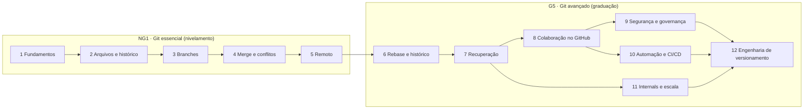

# Árvore de estudos de Git

Doze níveis, do primeiro commit à engenharia de versionamento de uma equipe. Os níveis 1 a 5 são a [NG1](../../disciplinas/NG1-git-essencial.md), no nivelamento; os níveis 6 a 12 são a [G5](../../disciplinas/G5-git-avancado-e-engenharia-de-versionamento.md), na graduação. A decisão está no [ADR 0010](../../docs/adr/0010-disciplinas-de-git-e-guias.md).

O objetivo não é decorar comandos. É saber em que estado o repositório está, prever o que um comando vai fazer com esse estado e escolher a operação que não destrói trabalho.

## Mapa



| Nível | Guia | Disciplina | Competências da NG1 | Cenários do laboratório |
| --- | --- | --- | --- | --- |
| 1 | [Fundamentos](1-fundamentos.md) | NG1 | NG1.c01 | N1-primeiro-commit, N1-staging-parcial |
| 2 | [Arquivos e histórico](2-arquivos-e-historico.md) | NG1 | NG1.c02, NG1.c03 | N2-restaurar, N2-versao-antiga |
| 3 | [Branches](3-branches.md) | NG1 | NG1.c04 | N3-criar-branch, N3-limpar-branches |
| 4 | [Merge e conflitos](4-merge-e-conflitos.md) | NG1 | NG1.c05 | N4-fast-forward, N4-conflito |
| 5 | [Git remoto](5-remoto.md) | NG1 | NG1.c06 | N5-clonar-e-enviar, N5-sincronizar |
| 6 | [Rebase e histórico avançado](../G5/6-rebase-e-historico.md) | G5 | — | — |
| 7 | [Recuperação e troubleshooting](../G5/7-recuperacao.md) | G5 | — | — |
| 8 | [GitHub e colaboração](../G5/8-colaboracao-github.md) | G5 | — | — |
| 9 | [Segurança e governança](../G5/9-seguranca-e-governanca.md) | G5 | — | — |
| 10 | [GitOps, automação e CI/CD](../G5/10-automacao-e-cicd.md) | G5 | — | — |
| 11 | [Internals e repositórios grandes](../G5/11-internals-e-escala.md) | G5 | — | — |
| 12 | [Engenharia de versionamento](../G5/12-engenharia-de-versionamento.md) | G5 | — | — |

Termos: [glossário](glossario.md).

## Níveis 6 a 12, na G5

A G5 começa depois da NG1 e de G1 (Linux e shell). O roteiro de cada nível está no [README da G5](../G5/README.md).

## Como cada guia é organizado

Todo guia tem as mesmas 17 seções, nesta ordem: objetivo, conceitos, explicação, comandos, sintaxe, exemplos reais, cenários de uso, erros comuns, riscos, boas práticas, exercícios básico, intermediário e avançado, desafio aplicado a este repositório, checklist de validação, critério de conclusão e próximo módulo.

- **Exercício básico:** reproduz o conceito num repositório de brinquedo.
- **Exercício intermediário:** pede um diagnóstico, explicar o estado antes de agir.
- **Exercício avançado:** nos níveis 1 a 5, é um cenário do [laboratório](#laboratório), conferido por script; nos níveis 6 a 12, é uma situação aberta, conferida pela checklist.
- **Desafio aplicado ao repositório:** usa este repositório como material real.

## Laboratório

```bash
python scripts/laboratorio_git.py listar                     # os 10 cenários
python scripts/laboratorio_git.py enunciado N4-conflito      # o que pedir
python scripts/laboratorio_git.py preparar N4-conflito /tmp/lab-conflito
# ... resolva com os seus comandos, dentro de /tmp/lab-conflito ...
python scripts/laboratorio_git.py conferir N4-conflito /tmp/lab-conflito
```

O script só prepara pastas vazias ou novas, fora de qualquer repositório, e nunca apaga arquivos seus. Para refazer um cenário, prepare numa pasta nova.

O portão da NG1 pede os 10 cenários resolvidos **sem consulta**, em pelo menos 3 dias distintos. Anote a data de cada `conferir` que passou na evidência do portão, em `registro/estado.yml` da sua branch de estudo.

## Regra de ouro dos exercícios

Exercício que escreve no Git roda numa **cópia descartável**:

```bash
git clone ~/caminho/plano-de-estudos /tmp/pe-treino     # clone local, sem rede
cd /tmp/pe-treino
```

- **Nunca treine na `main` nem na sua branch de estudo.** Elas são o seu registro real ([fluxo de git](../../docs/fluxo-git.md)).
- **Nunca faça `push --force`** para o GitHub neste repositório.
- **Ler é sempre seguro:** `git log`, `git show`, `git diff` e `git blame` no repositório verdadeiro não mudam nada.

## Desafios que leem histórico

Alguns desafios leem o histórico deste repositório: merges, PRs mesclados, autores e a vida de um arquivo. Eles pressupõem um clone com histórico de desenvolvimento, como o do repositório de origem ou um fork em que você já trabalha há algumas semanas.

A versão pública deste repositório é um espelho: tem um commit por publicação, sem merges, sem PRs mesclados e sem branches de estudo de outras pessoas. Se você estuda por ela, faça esses desafios num projeto seu com histórico (um trabalho da faculdade, um repositório open source que você clonou). O raciocínio pedido é o mesmo.

## Referências

- Scott Chacon e Ben Straub, *Pro Git*, 2ª edição, livre em git-scm.com/book/pt-br. Capítulos 1 a 3 para a NG1; 3, 5, 7 e 10 para a G5.
- Documentação oficial: git-scm.com/docs (`git help <comando>` mostra a mesma página no terminal).
- MIT Missing Semester, aula *Version Control (Git)*.
- Documentação do GitHub: docs.github.com.
